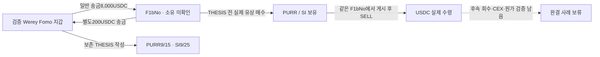

# Werey와 자금이 오간 별도 지갑의 THESIS 전 매수·후 매도

## 결론

**검증된 Werey Fomo 본지갑과 일반 USDC 송금이 오간 별도 주소 F1bNo에서, PURR·SI를 Werey의 보존 THESIS 전에 실제 매수하고 같은 주소에서 THESIS 후 매도한 흐름을 확인했다.** 기존의 추천 수수료 접점이나 본지갑 자체 매매보다 연구 가설에 가까운 후보다.

다만 **당시 유통 시총 100만 달러 이하 여부, 빠진 토큰 입금의 출처, 기존 물량과 추가 매수의 원가 분리, 실질 소유자는 미확인**이다. 현재 완결된 저시총 사례는0건이며, F1bNo를 Werey의 소유 지갑이나 악용 수익 주소로 확정하지 않는다. 일반 송금은 실제 경제 관계를 증명하지만 거래 의도나 동일인을 증명하지 않는다.

## 조사 범위와 주소

원래 Top10/raw141, 고정 **2026-08-08T04:43:41Z ≤ t < 2026-10-07T04:43:41Z**. 모든 시각UTC. 실제 매수별 시총과 THESIS별 시총을 구분하고, 300초는 시총 표본의 신선도 조건이다.

- 검증된 Werey 본지갑: `DmopudSGaQQenK4cW5NgmHUsexMB3sEJNn6n1EfLKs28`.
- 실제 자금 상대: `F1bNo6w7c56fhTrWaQtpEPjpL54zrhEf2j4uA1dqbM4B`.
- F1bNo USDC 계좌: `zUedY5KH9VL2Cr54CzqKCH19kXTQZ54D5DsT3p4frHo`.
- PURR mint: `8RNUw4N655VSrZKuhGdywhbSMDTrheguFPfxbpE2NZHQ` / decimals9.
- SI mint: `DEW9dSN6QpWyNthphCpMmAbZP1Q4cEKR9xQXAri98WDP` / **decimals6**.

## 자금 이동과 매수 순서

|UTC|확인한 사실|해석의 한계|
|---|---|---|
|9/10 23:44:51|Werey→F1bNo **8,000USDC**|F1bNo에는 기존200.903459USDC가 있었다. 송금의 목적·실질 소유는 미확인이다.|
|23:52:05|F1bNo→Werey **200USDC**|7분14초 뒤의 별도 일반 송금. 매매 수익이나 원금 상환이라고 하지 않는다.|
|23:52:50|F1bNo **1,000USDC 지출→90,692.298688282PURR 취득**|반환45초 뒤 실제 유상 매수. 기존 PURR 매매도 있어8,000의 특정 원금 귀속은 미확인이다.|
|23:52:58|F1bNo **1,000USDC 지출→323,089.114932MONEROCHAN 취득**|반환53초 뒤 실제 유상 매수. 이 토큰은 마지막 관측 물량을 THESIS 전에 처분했다.|
|9/15 23:39:50|Werey PURR THESIS|보존 Fomo 원문의 게시 시각. 절대 최초 공개 여부는 미확인이다.|
|9/16 23:23:35|F1bNo 게시 후 첫 관측 PURR SELL→**346.628525USDC**|같은 정확 mint와 owner의 실제 매도.|
|9/22 07:16:24|F1bNo 마지막 PURR SELL→**1,946.560989USDC**, 계좌 대상 잔액0|게시 후 추가 매수도 있어 전량을 게시 전 원가에 귀속하지 않는다.|

대표 일반 송금3개는 직접 getTransaction과 기존 indexed 원문의 signature·slot·historical owner·instruction·양쪽 USDC 잔액을 대조했다. **둘 모두 같은 QuickNode 제공자**이며 독립 제공자 확인이라고 표기하지 않는다. Swap의 소액 추천 수수료와 일반 송금을 분리했다.

## PURR: 게시 전 재고와 게시 후 처분

확보된 자료에서 THESIS 전 **28BUY/6SELL**, 마지막 게시 전 대상 잔액 **1,233,646.646503316PURR**다. 게시 후 **3BUY/15SELL**, 추가 매수 USDC 지출 **1,810.000000**, 매도 USDC 수령 **15,196.643524**다. 마지막 대상 잔액은0이다.

게시 전 마지막 관측 잔액과 게시 후 첫 매도 직전 잔액 사이에 **35.852957446PURR** 차이가 있고, 그보다 앞에도 한 차이가 있다. 따라서 현재 owner+USDC 조회만으로 게시 순간의 완전한 재고나 무상 입금의 출처를 확정하지 않는다. 정확 PURR 계좌 전체 조회로 두 공백을 확인할 예정이다.

**15,196.643524USDC는 매도 수령액이며 수익이 아니다.** 게시 후3번의 추가 매수, 이전6번의 매도, 토큰 입금 공백, SOL 수수료·계좌 비용을 분리해야 손익을 계산할 수 있다. 과거 유통 시총도 아직 승인되지 않았다.

## SI: 같은 별도 주소에서 반복된 시점 관계

THESIS는 **9/25 18:04:40**이다. F1bNo에서 게시 전 **10BUY/5SELL**, 마지막 게시 전 관측 잔액 **1,002,757.978826SI**를 확인했다. 게시 후 **4BUY/26SELL**, USDC 추가 지출 **1,444.420003**, USDC 수령 **27,877.679193**다. 마지막 관측은 **10/6 02:01:45**, 대상 잔액0이다.

Owner 조회는9/29까지만 닿지만 quote 계좌 조회로10/6 거래를 추가 확인했다. 전체 원가·게시 시점 재고에는 두 연속성 공백이 남아 있으므로 PURR와 같은 방식으로 정확 SI 계좌를 확인한다. 두 토큰에서 반복됐다는 사실은 조사 우선순위를 높이며 소유·공모·의도를 확정하지 않는다.

## 반대 근거와 다른 상대

**MONEROCHAN·ARTHUR·STONK·ZCAT은 이번에 확인된 마지막 물량이 해당 THESIS 전에0이 됐다.** THESIS 전 매수만 연결해 게시 후 악용 사례로 쓰지 않는다. HYPE는 THESIS 전 마지막 관측 잔액0 뒤 새로운 매수가 있으며, App도 게시 후 신규 매수다. ZEC는 무상/출처 미확인 이동이 많아 단순 선행 유상 매수로 분류하지 않는다.

YCWax는 Werey에 먼저1USDC를 보내고 이후200USDC를 받았지만, 확보한 같은 작성자 mint에는 유상 매수 근거가 없다. sQBw의100→2USDC와 다른 mint의10USDC BUY는 실제이나 Werey 보존 게시 토큰과 일치하지 않는다. 이 두 주소를 PURR/SI의 공동 매수 지갑으로 묶지 않았다.

|주소 · 토큰|게시 전 BUY/SELL|마지막 게시 전 관측 잔액|게시 후 BUY/SELL|마지막 관측 잔액|연속성 공백|
|---|---:|---:|---:|---:|---:|
|F1bNo · STONK|41/40|0.000000000|0/0|0.000000000|2|
|F1bNo · PURR|28/6|1,233,646.646503316|3/15|0.000000000|2|
|F1bNo · HYPE|6/13|0.000000000|8/19|0.000000000|37|
|F1bNo · App|0/0|이전 관측 없음|2/1|0.000000|0|
|F1bNo · MONEROCHAN|22/9|0.000000|0/0|0.000000|1|
|F1bNo · ZCAT|9/3|0.000000000|0/0|0.000000000|2|
|F1bNo · ZEC|0/0|이전 관측 없음|2/6|0.00000000|11|
|F1bNo · SI|10/5|1,002,757.978826|4/26|0.000000|2|
|F1bNo · ARTHUR|28/8|0.000000|0/0|0.000000|0|
|F1bNo · STUPIDINU|6/1|0.000000|0/0|0.000000|0|
|YCWax · ZEC|0/0|0.00109874|0/3|0.00000000|3|
|YCWax · HYPE|0/0|0.002092712|0/0|0.000000000|0|
|YCWax · STONK|0/3|0.000000000|0/0|0.000000000|3|

이 표는 확보된 owner+USDC 계좌의 교집합이며 모든 토큰 계좌·native quote·평생 이력의 완전한 표가 아니다. BUY-only anchor가 있는 항목은 보존 actual source BUY를 기준으로 비교한다.

## 본지갑과 기존62개 ARTHUR 매수자

Werey USDC **9/29 00:00~10/7 04:43:41 별도8.197일 query**는9,267고유 거래와 빈 footer로 종료했다. owner USDC 잔액9,266연속 대조에서 차이0이다. 기존62개 주소와78개 전송이 겹치지만 모두 같은 swap의 비용·수수료·제3자 recipient 대안이며 일반 사적 송금이 아니다. 본지갑의110USDC 매수 비용을 상대 지갑 자금 공급으로 분류하지 않았다.

이 종료는 이전60일20,000행 prefix의 **`446194389:216`**를 대체하지 않으며 **9/11~9/29 미확보 구간**도 채우지 않는다. 62개는 제한된 시장 창에서 선정한 주소이며 전체 ARTHUR 매수자 또는 원래 Top10 연구 완료를 뜻하지 않는다.

시점도 구분한다. Werey 본지갑의 최초 **관측** ARTHUR BUY는 보존 raw198 data190의 **9/30 02:10:34·2,000USDC**다. raw2286의 **10/2 08:00:37·110USDC**는 역사 시총이 승인된 개별 실제 BUY anchor이며 최초 매수 시점이라고 하지 않는다.

## 거래 확인 링크

|UTC|내용|실제 거래와 원문|
|---|---|---|
|2026-09-10T23:44:51Z|8000000000 raw USDC 일반 공급|[거래](https://solscan.io/tx/4iAYy8JVVnVFg2MceLVARCsgUmreToZ8YMEAJB8bwxU5JGN4aufWwU7yEoixeerWBdjzpmYtr6ywpgxT3QPLZBNn) · raw3172 `/response/result`|
|2026-09-10T03:40:56Z|100000000 raw USDC 일반 공급|[거래](https://solscan.io/tx/y7XFuCbcQTTMMUzsZ2QCxJyyNCD1qsh4i9GvYFrUwHbjM3mwiZh4M96MZVGkjDu7v6Fdg4FBV8B3dj1gNYZ6bwS) · raw3177 `/response/result`|
|2026-09-10T02:21:43Z|200000000 raw USDC 일반 공급|[거래](https://solscan.io/tx/pVbznACqw92NAbiwhaUuSLLnXjeiNLNNCTsRLY6PTE5CGR1bDUn7krNDz8pstYvS3J5ZJk5B3xuBB2fzDN2BspQ) · raw3182 `/response/result`|
|2026-09-10T23:52:50Z|F1bNo PURR BUY|[거래](https://solscan.io/tx/3Q1ZGLUM4oKDhMgSMi82NFBghjKJkmEWpwjkJEm2jgWjaZfmgKD1EnAheEuv6dXV3Ysffu6Q4swh6xeYCnKSXxYD) · raw3174 `/response/result/data/261`|
|2026-09-10T23:52:58Z|F1bNo MONEROCHAN BUY|[거래](https://solscan.io/tx/65J9hUmkRDfWVGXHboHVYdYTkzmRSwThsCtMm5ADHwxYKgUu7beUjGmDZwenYTP8VFc4c8nhLGty4zZbX1vkzVY) · raw3174 `/response/result/data/262`|
|2026-09-16T23:23:35Z|F1bNo PURR SELL|[거래](https://solscan.io/tx/jsGZaUWvAq2nr7jLic9FypqeR3Nw4nEjCuwGRbCvymupfXmkUgwKPmgEVzm2RhUFs6W3adC4rhWM3bbZ29YxXTb) · raw3198 `/response/result/data/442`|
|2026-09-22T07:16:24Z|F1bNo PURR SELL|[거래](https://solscan.io/tx/764uWK2PtU3iGZKbEe5D9YG1TV3FM3XT22umQXuDpVj4VTavGFpXyGwQZJvt9G1n9GwQMwcr1ysaKjmNBZ8Rz96) · raw3199 `/response/result/data/414`|

THESIS 원문raw2156과 source locator·정확 mint·UTC는 DB 및 근거raw3208에 보존했다. 탐색기의 현재 USD 환산을 원가·수익으로 쓰지 않는다.

## 저장·coverage·다음 작업

Signed same-mint/USDC 반대 delta·성공·실제 owner 서명으로 검산한327고유 swap(**169BUY/158SELL**)을 추가했다. canonical **trades4,540/edges440/states62**, 기존61states/11wallet resolutions/4,213trades/440edges/Fomo1,338(원래10명의고정구간404건)/matches73을 보존했다. 새 소유권 변경0, 새 전송 중복 추가0이다. RPC30/30, 나머지 외부 source0·5Luna/max RO/network0. 시장 전체 조회와 BQ 신규0이다.

F1bNo owner2,000행은커서 **`451737959:635`**, USDC3,114행은 **`454070898:655`**가 남았다. USDC 마지막114행은 짧은 페이지이지만 footer가 아니므로 완료로 표시하지 않았다. sQBw owner428/USDC251와 YCWax owner475/USDC568는 각각 빈 페이지로 해당 query를 마쳤다. 전체 지갑·평생 이력 완전성을 뜻하지 않는다.

시총검토raw3207/근거raw3208/검토raw3209, state `initial_top10_werey_funded_counterparty_same_token_exit_review_v1`. 작업자164건 subset과본체327건 union을 분리했다. SI decimals는6, HYPE14BUY/32SELL, STONK41BUY/40SELL로 원문을 재검산했다.

다음은 **정확 PURR·SI 계좌의 입금 공백→실제 공급·보상 여부→게시 재고와 매도 원가→USDC 후속 회수 및 정확 CEX endpoint** 순서다. 당시 시총 조건을 먼저 확인하고 적격 전 새로운 전체 토큰 군집을 확대하지 않는다. 연구 목표는 진행중이다.
