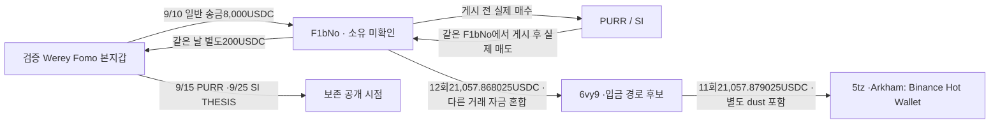

# Werey 자금 상대의 게시 전 매수·후 매도와 Binance 라벨 회수 경로

## 이번 결론

**Werey 본지갑과 일반 송금이 오간 별도 주소 F1bNo의 PURR·SI 실제 매수→Werey THESIS→같은 F1bNo의 매도 흐름을 정확한 토큰 계좌로 대사했다.** 두 계좌는 잔액0에서 시작해 매수·매도·별도 배분 입금을 거친 뒤 다시0으로 끝나며 정수 단위 차이가 없다.

**F1bNo→6vy9→Arkham이 Binance Hot Wallet로 표시한 정확한5tz 주소의 실제 USDC 경로도 연결했다.** 다만 역사적 유통 시총100만달러 이하 조건은 미확인이다. 고객별 입금 주소·같은 소유자·의도·특정 토큰의 수익 회수는 확정하지 않는다. 연구의 엄격한 저시총 완결 사례는 여전히0건이며, 관측 가능한 자금·시점 사례는 보고서에 담을 수준으로 구체화됐다.

## 1. 범위와 관계도

원래 Top10/raw141. 고정 **2026-08-08T04:43:41Z ≤ t < 2026-10-07T04:43:41Z**. 모든 시각UTC. F1bNo는 검증된 Fomo/Top10 계정 주소가 아니라 **검증된 Werey 주소와 실제 전송이 오간 별도 주소**다. 동일인의 소유라는 판정은 없다.

마지막12회·11회는9/15~10/1 전체 해당 경로의 문맥이다. 일부는 PURR 마지막 매도보다 앞서고, SI 마지막 매도보다 모두 앞선다. **전체21,057.868025USDC를 PURR/SI 매도 수익으로 귀속하지 않는다.** 같은 거래소 핫월렛은 공통 고객 입금 주소의 증거가 아니다.

|역할|정확한 Solana 주소|
|---|---|
|검증 Werey 본지갑|`DmopudSGaQQenK4cW5NgmHUsexMB3sEJNn6n1EfLKs28`|
|실제 자금 상대 F1bNo|`F1bNo6w7c56fhTrWaQtpEPjpL54zrhEf2j4uA1dqbM4B`|
|회수 중간 owner6vy9|`6vy9yXosShBGNPU5SbqTods2CF8YLnpELcJf5rrSEf9J`|
|6vy9 정확 USDC 계좌|`3KsqqvzFZGFL5puVGKW1pLFBC4RtNqJUbPieZ33GcWdC`|
|Binance Hot Wallet 제공자 라벨 owner|`5tzFkiKscXHK5ZXCGbXZxdw7gTjjD1mBwuoFbhUvuAi9`|
|후속 정확 USDC 계좌|`7KJjY7rArbydeLBF7gQ5LdqXRKRYyPArT99NEctsHsgU`|

## 2. 에어드롭·배분을 실제 매수와 분리

### PURR

정확 mint `8RNUw4N655VSrZKuhGdywhbSMDTrheguFPfxbpE2NZHQ`, decimals9. ATA `6wDnv9KvAKydvgq5TBiAAdGMMH5QsY3gUjRBMNFe1f6n`, raw3211의82행과3212 빈 footer를 확인했다.

- 실제 유상 **31BUY/21SELL**, 대가 없는 관측 입금8건, 대상 잔액 변화 없는22행이다.
- THESIS **9/15 23:39:50** 직전 계좌 재고는 **1,233,646.646503316PURR**다.
- 이전 첫 공백은4arR source의net **14.726639683PURR** 일반 전송1건으로 설명된다. Source authority가 서명했고 F1bNo 서명·USDC 대가는 없다. 3% token transfer withholding을 gross/net과 구분했다.
- 게시 후 첫 매도 직전 공백은5KX source가20수취인에게 배분한7건의net **35.852957446PURR**다. 목적은 보상·수수료·에어드롭 대안이며 사적 자금 관계로 승격하지 않았다.
- 게시 후 **3BUY/15SELL**을 거쳐9/22 07:16:24 마지막 매도에서 잔액0이다.

원시 수량식:

`2,353,190,645,213,928 BUY + 50,579,597,129 별도 입금 − 2,353,241,224,811,057 SELL = 0` (9 decimals).

따라서 **배분 입금 때문에 전체 보유를 선행 유상 매수로 해석한 것은 아니다.** 실제 매수31건은 성공·본인 source authority 서명·대상 증가·USDC 지출·swap 로그를 별도로 검증했다.

### SI

정확 mint `DEW9dSN6QpWyNthphCpMmAbZP1Q4cEKR9xQXAri98WDP`, **decimals6**. ATA `E7JAmn4nDCvJ5H3wJmbe6gvUhZvTmKAMRRBe65SgcdqN`, raw3213의158행과3214 빈 footer를 확인했다.

실제 유상 **14BUY/31SELL**, 게시 후 별도 분배 수령44건, 대상 변화 없는69행이다. 44건은 같은 HuBMe source authority에서13~17수취인에게 분배한 Token-2022 전송이다. F1bNo 서명·USDC 대가는 없으며 보상·에어드롭 대안을 유지했다. 두 기존 공백은4건+49.851689SI와40건+545.505270SI로 정확히 메워졌다.

THESIS **9/25 18:04:40** 직전 재고는 **1,002,757.978826SI**다. 게시 전10BUY/5SELL, 게시 후4BUY/26SELL을 거쳐 **10/6 02:01:45** 마지막 매도에서0이다.

`2,176,805,657,963 BUY + 595,356,959 별도 수령 − 2,177,401,014,922 SELL = 0` (6 decimals).

## 3. 실제 스왑의 USDC 현금흐름

|대상|BUY에서 실제 USDC 지출|SELL에서 실제 USDC 수령|관측 스왑 순현금흐름|
|---|---:|---:|---:|
|PURR|8,238.364600|19,269.683630|+11,031.319030 USDC|
|SI|11,242.381237|33,586.185119|+22,343.803882 USDC|

이는 정확 대상 계좌의 유상 스왑별 owner USDC 잔액 변화 합계다. **USD 수익 또는 THESIS 악용 수익으로 계산하지 않았다.** 무상 수령의 취득 원가·게시 후 추가 매수·실제 네트워크 비용 부담자·다른 지갑 원가·실질 소유가 남아 있다. 특히 THESIS의 영향이나 절대 최초 공개 시점도 미확인이다.

## 4. USDC 회수 주소에서 Binance 라벨 주소까지

6vy9 정확 USDC 계좌의 고정60일 query는 raw3226 **43고유 거래+3227 빈 footer**로 종료했다. 43행에서 대상 잔액 연속성 차이는0이다.

- **정확 F1bNo에서12회·21,057.868025USDC**가 들어왔다.
- 별개의 유사주소 F1bNY에서20번·**0.011USDC dust**가 들어왔다. F1bNY를 F1bNo로 병합하지 않았다.
- **6vy9 source authority가11회·21,057.879025USDC 전부를 같은5tz owner의7KJj 계좌로 보냈다.** 처음과 마지막 계좌 잔액은0이다.
- Owner query31행(raw3231)+footer3232는 위43개의 부분집합이다. 관측된 다른 최종 mint·native SOL 잔액 변화는 없고, 검증 Werey 본지갑의 직접 입금도 해당43/31행에 없다. 다른 토큰 계좌·체인·기간의 부재라는 뜻은 아니다.

대표 경로:

|UTC|방향·실제 수량|확인 링크|근거|
|---|---|---|---|
|2026-09-26T06:38:58Z|F1bNo→6vy9 **7,026.531285USDC**|[입금 확인](https://solscan.io/tx/2Bda9kcpLT2pkpRu9RSjAw2yFU8G9bUYjKfgMNLKDKHqfeNVFaLzWH9Uu83SLyQoT3YwBWvQ429UvyZVv7G5pcEq)|raw3200 data409·직접3224|
|2026-09-26T06:42:55Z|6vy9→5tz **7,026.532385USDC**|[후속 송금 확인](https://solscan.io/tx/SVBH6U81tRV6xgPcjQRZ79oKBvPrN9EJfG6HBmHzRAqbq4YCoZtkYRHbXfNkTk6KdsWS6zED26R9h7bCUmojfRD)|raw3226 data25·직접3230|

두 전송은 **3분57초 간격**이며0.0011USDC 차이는 별도 dust를 포함한 잔액이다. 직접 getTransaction은 기존 indexed와 같은 QuickNode 제공자의 메서드 교차 확인이며 독립 제공자 증거라고 하지 않는다.

PURR 마지막 매도 뒤의 F1bNo 일반 USDC 출금은9건·**18,004.717677USDC**다. 이중7건·17,879.717677은6vy9,10은DXAh,115는3TW6로 간다. 중간에 다른 토큰 매매와 자금이 섞이므로 전체를 PURR 매도대금으로 연결하지 않았다. SI 마지막 매도 뒤에는 확보된 F1bNo query에서 일반 출금을 관측하지 못했다.

### 라벨과 고객 귀속

**5tz의 `Binance: Hot Wallet` 라벨 출처는 기존 Chrome 원문raw2532**이다. raw2544/2545는 다른8FX 주소에서 같은5tz로의 실제 전송 RPC이며 라벨 자체의 출처는 아니다.

6vy9의 현 자료는 한 주소에서 같은 핫월렛으로 잔액을 반복 정리한 **입금 경로 후보**다. 새 Arkham 방문raw3223은 보안 확인 화면, Solscanraw3228은403으로 주소 라벨을 확인하지 못했다. 반복 재시도·공유 핫월렛 전체 추적은 중단했다.

기존 DET 계열의 입금 라벨 주소는 **8FXdW1**이며 이번6vy9와 다르다. 두 경로가5tz 핫월렛에서 만난다는 사실을 공통 고객이나 동일인으로 사용하지 않는다. 같은 정확 고객 입금 주소의 겹침은 아직 확인되지 않았다.

## 5. 저시총 조건이 남은 이유

PURR exact CoinGecko 계약 조회raw3219는404이며 provider ID·역사 유통 시총을 확인하지 못했다. SI는raw3220에서 exact mint→`super-inu-2`/6decimals를 확인했지만9/22 최초 매수 주변(raw3221)과9/25 THESIS 주변(raw3222) 차트는 비었다.

**raw3229는 빈 차트가 아니다.** 10/2 양수 유통 시총 표본24개를 반환했다. 마지막 SI BUY **06:40:19** 직전 표본은06:00의 **USD30,361,216.92072146**,2,419초 전이다. 다음07:00 표본은 매수 후다. 운영 기준300초를 넘으므로 실제 BUY 시총은 `pending_cap`을 유지한다. 오래된 고시총 표본은 별도 문맥으로 기록했고 적격이나 초과 제외를 임의 확정하지 않았다.

PURR31BUY·SI14BUY는 모두 시총 보류다. SI9/26·9/29 일부 BUY 날짜의 추가 차트는 미조회이며, 현재값·FDV·총발행량을 유통 시총 대신 쓰지 않았다. **기준 승인 전 새로운 전체 토큰 매수 군집이나 BQ 시장 수집을 실행하지 않는다.**

## 6. 저장과 다음 조사

원문·배분 대안·정확 수량/UTC·라벨/전송 구분·종료 footer·공백 해소를 저장했다.97개 대상 swap은 기존 거래와 일치해 보존했고 신규 spot trade는0이다. 실제 일반 자금 전송25개를 추가해 **trades4,540/edges465/states63**이다. 이전62states/11wallet resolutions/440edges/Fomo1,338·고정10명404/matches73을 그대로 보존했다.

5Luna/max는DB RO·외부0으로 검토했다. 본체RPC15/30·시장5/20·Chrome1/1·공개탐색기1/2, Fomo/Bridge/BQ0이다. 미사용 예산은 해제했다. F1bNo owner2,712·USDC3,114 각각 query 종료, 정확 PURR82/SI158 query 종료,6vy USDC43/owner31 query 종료다. **지갑 전체 평생 이력이나 원래Top10 연구 종료가 아니다.**

시총raw3238/근거raw3239/검토raw3240, state `initial_top10_funded_token_inventory_and_Binance_endpoint_review_v1`. 다음은 역사 cap의 독립 근거가 가능한 경우만 보완하고, 원래Top10의 미확보 공개/BUY-only/60일 기초와 이미 적격인 실제 BUY 사례에서 사적 경제 연결을 이어간다. 닫힌 계좌·62ARTHUR 대상·Binance 공유 핫월렛 전체를 다시 수집하지 않는다. 소유·의도·고객 신원·USD/PnL은 미확정으로 남긴다.

## 추가 조사 — 배치062: 유상 재고 전량 매도와 소액 상대의 성격

2026-10-10 조사. 사용자가 Werey/PURR을 더 조사하도록 지정한 범위다. 기존 완결된 본지갑·F1b·PURR·CEX 계정 조회는 재사용했다. 수령 상대 두 곳만 새로 조회하고, 정확한 PURR의 게시 전 가격 원천을 확인했다. **확정 뒷지갑·악용 수익·100만 달러 이하 적격 사례가 새로 확정되지는 않았다.**

### 1. 게시 전 별도 지갑의 유상 재고가 게시 후 모두 매도됐다

Werey가 2026-09-15 23:39:50 UTC에 남긴 가장 이른 보존 THESIS 당시 F1b는 1,233,646.646503316 PURR을 보유했다. 최소 **1,233,631.919863633개는 유상 매수에서 온 재고**이며, 나머지 최대 14.726639683개에는 대가 미확인 이전분이 섞인다. 원래 매수·매도·소액 이전을 정확히 대사한 결과다. 절대 최초 대외 공개 시각은 미확정이다.

게시 뒤 유상 매수 3건으로 157,946.904401926개, 대가 미확인 이전 7건으로 순수령 35.852957446개를 추가 취득했다. 이 합계가 게시 뒤 매도 15건의 1,391,629.403862688개와 정확히 같다.

`1,233,646.646503316 + 157,946.904401926 + 35.852957446 = 1,391,629.403862688`

마지막 매도는 9월22일 07:16:24 UTC이며 잔고는0이다. 따라서 **THESIS 당시 재고가 이후 모두 처분됐다는 수량 흐름은 확인**된다. 개별 매도마다 어느 취득 물량이 팔렸는지는 구분할 수 없다. 본지갑→F1b 8,000 USDC 공급과 역방향200 USDC 송금이 실제 연결 근거지만, 계정 소유자·통제자가 같다는 증명은 아니다.

추가 원문 검산에서는 F1b→Werey의 실제USDC 수령36건, 총212.100249 USDC를 확인했다. 이 중200 USDC 일반송금1건과 나머지소액35건/12.100249 USDC를 분리한다. 소액은 스왑 관련 로그와 함께 나타나 수수료·추천 보상 대안이 있다. 정확한 historical owner 잔액과 top-level 전송이 일치해 실제 수령 자체는 맞지만, 이를 원금·수익의 반복 반환35회나 공동소유 증거로 쓰지 않는다.

| 구간 | PURR 유상 매수 지출 | PURR 매도 수령 | USDC 순현금흐름 |
|---|---:|---:|---:|
| 보존 THESIS 전 | 6,428.364600 | 4,073.040106 | −2,355.324494 |
| 보존 THESIS 후 | 1,810.000000 | 15,196.643524 | +13,386.643524 |
| 확보된 PURR 거래 전체 | 8,238.364600 | 19,269.683630 | +11,031.319030 |

이는 실제 스왑의 USDC 현금흐름이다. 무료처럼 보이는 이전의 대가, 별도 비용 및 소유 귀속이 불명확해 **실현 수익이나 THESIS 악용 수익으로 발표하지 않는다.** 게시 후 신규 매수도 있으므로 전부 게시 전 매집분이라고 하지 않는다.

### 2. 115 USDC 수령 지갑: 추가 양방향 연결은 있지만 PURR 사례는 아니다

수령자 `3TW6ntRGamgJgCSvTa3S6z7NoGEaQCEMLF441bAyHnji`가 9월19일 08:27:02 UTC에 F1b로6.7 USDC를 보냈다. 실제 historical owner, 서명자, 양쪽 잔액과 top-level 송금을 raw4039/4049로 대조했다. [거래 확인](https://solscan.io/tx/5dn6tQVzbC5x7YaXwqZLHb4S8cDh1CUongeQ2GFJ9CvHhubLJ9dn3DPmpMNo97Qbg17h315F4PJWhMuXJwBu85J6). 두 조회는 같은 provider의 다른 방법이다. 별도 Nodit 검증은 HTTP401(raw4047)로 실패해 독립 원천 일치라고 하지 않는다.

9월30일09:43:48 UTC에는 F1b에서115 USDC를 받고,21초 뒤 ARTHUR로 표기된 최종 mint `6e8LLHkqCTa4mzGuL1PoUxSfeHmDeceJ3DaJSSUNg937`를46,291.662769개 취득했다(raw4050). Jupiter 실제 투입114.05 USDC와 별도0.95 USDC를 합한 지갑 지출은115 USDC다. 별도0.95 중0.2375 USDC가 F1b로 돌아왔다. 이 소액은 동일 스왑 내 분배이므로 수수료·추천 보상 대안을 함께 기록한다. [스왑 확인](https://solscan.io/tx/WiMRvDRBsZBPkT45YBFoDaQWA5NhrbcvMsgMEFot67sd6ywtiVRydze3C7dcCgAMK4nor73JwXFzW7dY3d866tF).

이 주소의 성공 owner 조회11건과 정확USDC 계정19건은 각각 빈 후속 페이지로 닫혔다(raw4042/4048). 이 한정된 자료에 PURR/SI 취득·매도가 보이지 않는다. 모든 토큰 계정·실패 거래·수명 전체를 확인했다는 뜻은 아니다. Werey의 PURR 뒷지갑으로 승격하지 않는다.

### 3. 10 USDC 수령 지갑: 반복 소액 분배를 소유 연결로 쓰지 않는다

`DXAhbEJn2YMEyuQByeRakDyu2HhQ1NVu2sVWgQLxWBWU`의 USDC 계정은 10 USDC 입금 이후 첫400건만 확보했다. 실제 범위는9월30일06:01:48–10월1일10:58:01 UTC, 미완료 cursor는 `452267420:933`이다. owner 거래의 별도138건도 후속 페이지가 남아 있다. 처음60일/1,000건 조회는504로 실패했고, 기간과 건수를 줄인1회 재시도 후 확보한 자료다. 완료된60일 이력으로 취급하지 않는다.

첫400건에서 수령자 서명이 없는1 USDC 이하 양수 변화226건, 합계39.425217 USDC가 확인됐다. 이 중224건은 스왑 로그 및 Fomo 서비스 AgmL 수수료 대납과 함께 나타난다. 수수료·추천 보상·서비스 분배 가능성이 있어 각 송금자의 소유 지갑 군집으로 사용하지 않는다. 현재 Arkham의 첫 공급자 표기도Fomo AgmL이며, 개인 소유 라벨은 없다(raw4036/4040).

이 주소가10월3일13:57:01 UTC에 Relay 주소7uTT로1,000 USDC를 낸 실제 DepositToken 거래도 확보했다. 개인 주문의 목적지는 아직 대응하지 않았고, 앞서 받은 F1b의10 USDC가 이 출금에 포함됐다고 귀속하지 않는다. 서비스 전체 자금 흐름은 확대하지 않았다.

### 4. PURR 역사 가격 원천은 확보, 유통 시총 조건은 보류

정확mint의 GeckoTerminal 풀 목록20개에서8개가 보존THESIS 이전 생성으로 표시됐다(raw4041). 실제 매매 경로에서 반복 확인된 Raydium Ad7pb 풀과 별도 USDC 풀의 게시 전 완결된1분봉을 처음 확보했다(raw4043/4044).

| 풀 | 마지막 확보 분봉 시작 UTC | 종가 USD | THESIS까지 경과: 시작/마감 기준 |
|---|---|---:|---:|
| Ad7pb… / HYPE | 9월15일23:36:00 | 0.0076961469985351435 | 230초 /170초 |
| 5oF8… / USDC | 9월15일23:38:00 | 0.008095583287426402 | 110초 /50초 |

두 가격은 같은 시각의 확정 전체 시장 가격이 아니다. 가격은 확보됐지만 역사적 유통량이 없고, 반환된20개 풀 모두 현재 `market_cap_usd=null`이다. 현재 FDV·공급량을 과거 값으로 대신하지 않는다. **`pending_cap`을 유지하며 USD1M 이하 토큰으로 확정 편입하거나 전체 토큰/BQ 수집을 시작하지 않았다.**

### 판정과 다음 단계

가장 강한 것은 **실제 공급 관계가 있는 별도 지갑의 게시 전 유상 재고→게시 후 전량 매도**다. 새 소액 수령 상대를 추적한 결과는 소유 증거를 강화하기보다 수수료·추천 보상 대안을 드러냈다. Werey 본지갑과 F1b가 같은 정확 개인 CEX 입금 주소를 썼다는 새 증거는 없으며, PURR 최종매도 뒤6vy로 간17,879.717677 USDC 역시 다른 토큰 현금흐름과 섞여 PURR 회수액으로 확정하지 않는다.

우선순위는 정확PURR의 게시/매수 당시 유통 시총 원천, 추가 실제 원금 공급·반환/개별 귀결의 비서비스 근거다. 기존 완결 조회나 공유 서비스 팬아웃은 반복하지 않는다. 시총 조건이 충족되기 전에는 이 건을 **소유 미확정·시총 보류인 예비 사례**로 유지한다.

근거4057, 검토4058, 시총 검토4056. RPC12회(504/401 포함), Chrome2회, 시장자료3회, Fomo·Bridge·BQ0회. 기존94 state·11 wallet resolution·4,569 trade·645 edge는 보존하고 검토state1 및 실제6.7USDC TRANSFER1만 추가했다. 연구 전체 완성·범위 소진을 선언하지 않는다.
