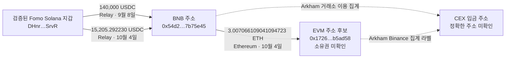

# Yeon__ (Fomo) 지갑의 CEX 입금 주소 추적

## 과거 THESIS 추가 확보 — 2026-10-07

최신 [저시총 THESIS 보고서](lowcap-thesis-review.md)와 review raw2067/validation raw2068을 따른다. 이전 slice의 연우 THESIS0 상태 이후, 별도 REST 게시글 경로에서9건(9/25–10/6)을 회수해 SQLite 원문 관측과 Fomo 이벤트에 추가했다. CZ 글은10/6 13:31:30 UTC이며 두 기존 실제 매수보다3870/682초 뒤다. Pool은 canonical PancakeSwap V3 factory/getPool과 공식 Swap ABI로 확인했고 final raw output이1726 수령액과 맞는다. 수령주소의 소유권, 절대 첫 공개와 뒷지갑 선행매수·수익은 미확인이다.

CZ는 당시 총발행량×직전 가격 약$844,583.53의 FDV 예비 대상이다. baton은 게시45초 전 provider cap 약$14.08M으로 제외,7개는 보류한다. 두 달 전체 THESIS를 확보한 것은 아니다. 기존 wallet trace와 resolution은 보존했다. 최신 frontier는 `collector_state.lowcap_thesis_research_v1`이며 아래 내용과 이전 `yeon_wallet_trace_v1`은 전송 추적 snapshot이다.

## 최신更新 — 두 달 범위, 2026-10-07

현재 기준 결과는 [한글 두 달 추적 보고서](two-month-review.md)다. 구간을 8월 7일부터 10월 7일까지 확장해 **54d2→c67a→Binance 51 USDC3건/588,098.805041163975619333**, **54d2→32f023→Binance 51의12.5BNB** 경로를 확인했다. USDC3쌍 중9/8 한 쌍은 양쪽 RPC, BNB3거래는 transaction/receipt/header가 검증됐다. CEX 라벨은 서비스 assertion이며 같은 고객 계정·지갑 소유권은 미확인이다.

`54d2→1726→Relay` Ethereum USDC3건/114,345.733494는 Bridge 도구가 기존 Fomo Solana 주소로 대응했다. 도착 당시 token-account owner/delta의 독립 RPC 검증은 남았다. CZ 공개 BUY 전 source-address 전송14,668행/수령주소3,711개를 회수했지만 조사한 제보·직접 공급 상대와의 교차는0이었다. 최초 공개 CALL과 두 달 Fomo 기록은 확보하지 못했다. `32f0a`와 실제 native 전달 주소`32f023`은 구별하며 유사 주소·미검증 BNB 토큰 로그를 관계에 승격하지 않는다.

SQLite의 조회12개/15,826행과 신규trace15행, review raw2014 및 saved frontier를 따른다. 아래는 **01:43 UTC 당시 초기 조사 snapshot**이며, 초기의 미확인 사항 중 이번에 보완된 것은 위 최신 보고서로 대체한다.

검토 시각은 `2026-10-07T01:43:16Z`(UTC)다. 기준 프로필은 [Fomo yeon__](https://fomo.family/profile/yeon__)이며, 보존된 스냅샷에서 전체 기간 순위는 92위였다. 이번에는 최근 30일 동안 Solana USDC가 이동한 내역과 Relay 주문을 대조하고, BNB·Ethereum 연결 주소의 중앙화 거래소(CEX) 흔적을 살펴봤다.

## 판정

- Fomo에서 확인한 Solana 주소 `DHnrkgve2u4nGAmzSXdWoZSib8ksFea2xxz7N4asSrvR`는 서로 다른 매수 알림 3건과 성공한 온체인 거래의 서명자, 토큰 잔액 변화, USDC 잔액 변화가 맞아 지갑으로 확인됐다.
- BNB·Ethereum 주소 후보 `0x172695ac783cc308fc3699e0a5d161494eb5ad58`는 Arkham의 Fomo 화면에서 관측됐다. Arkham은 `@yeonwoo1102?` 연결을 낮은 신뢰도의 AI 예측으로 표시한다. 소유권이 검증되지 않아 `wallet_resolutions`에는 추가하지 않았다.
- 검증된 Fomo Solana 지갑에서 Relay를 거쳐 BNB 주소 `0x54d209d9d224a615e0e5f0476644886897b75e45`로 도착한 USDC 주문 2건을 출발·도착 거래 내역과 대조했다. 이어 같은 주소 문자열을 쓰는 Ethereum 지갑에서 후보 주소 `0x172695ac783cc308fc3699e0a5d161494eb5ad58`로 **3.007066109041094723 ETH**가 전송된 것도 확인했다.
- **초기 검토 시점에는 정확한 CEX 입금 체인과 주소를 확인하지 못했다.** Arkham의 거래소 이용 내역은 서비스가 집계한 라벨이다. 이번에 살펴본 범위에서는 두 주소가 동일한 체인·입금 주소로 보내는 관계를 확인하지 못했다. 이는 CEX 회수가 없다는 뜻은 아니다.

## 확인된 자금 흐름

| 시각 (UTC) | 출발 내역 | 도착 내역 | 거래 확인 링크 |
|---|---|---|---|
| 2026-09-08 19:37:35 → 19:37:39 | Solana USDC 140,000 | BNB USDC 139,548.477748 → `0x54d209d9d224a615e0e5f0476644886897b75e45` | [Solscan 출발 거래](https://solscan.io/tx/4dipFnstNuumD1y6gZQJPqnoWbmPNsuU7ad7VzKErseRUT6sdGtrYxkohcTUaUQ1hTR6X87goPKzZmwRbjzqob5D) · [Relay 주문](https://relay.link/transaction/0x1788896250c64a2061b4f71ef8a33979787b28da00f207088f156c16ed5de27c) · [BscScan 도착 거래](https://bscscan.com/tx/0x2714fdde67eef3b1f3a887b2653aac294db648b7eb85c93964831358c0a21e36) |
| 2026-10-04 09:44:18 → 09:44:20 | Solana USDC 15,205.292230 | BNB USDC 15,156.229443 → 같은 BNB 주소 | [Solscan 출발 거래](https://solscan.io/tx/3ddGC4nVhYJuVuiWBtGq7P4aKPQdKpc9Tof36fNZs1D8wVNibHWCduKri74nByAGBiiaWTtW9FL29D31mFSa9SYN) · [Relay 주문](https://relay.link/transaction/0x1791107052b1947d70da3c8f1f9b992586109e5cfe52fd40feeb057c9585b3) · [BscScan 도착 거래](https://bscscan.com/tx/0xf1682367b013137f28a9a410143ad1cdc1658fa07b1918191a11bbf1f80ce7d4) |
| 2026-10-04 17:09:23 | Ethereum 네이티브 ETH 3.007066109041094723 | `0x54d209d9d224a615e0e5f0476644886897b75e45` → `0x172695ac783cc308fc3699e0a5d161494eb5ad58` | [Etherscan 거래](https://etherscan.io/tx/0x5484d5ce10c673596350eb66ae8e37f415b197c39dd085f21f5222dcca5130de) |

Relay 화면은 Solana 출발 서명과 BNB 도착 거래를 하나의 주문으로 연결한다. BscScan에서는 도착 USDC의 정확한 전송 수량을 확인했다. Relay 화면의 도착 수량은 반올림되어 표시된다. 이번 증거는 블록 탐색기 화면에서 확인한 내용이며, 직접 RPC 영수증 원문은 아니다. 출발과 도착 수량이 다른 점은 거래 비용이나 수익으로 계산하지 않았다. 뒤이어 확인된 ETH 전송은 별개의 자금 이동이다. 이 ETH가 앞서 도착한 USDC에서 나왔거나 두 EVM 주소의 소유자가 같다는 점까지 증명하지는 않는다.

### Fomo 매수 알림과 시각 대조

Solana에서 BNB 후보 지갑으로 보낸 소액 Relay 거래 두 건이 Fomo의 CZ 매수 알림과 거의 같은 시각에 나타났다. 3,000 USDC 주문은 `2026-10-06T12:27:00Z`에 도착했고 매수 알림도 같은 초였다. 5,000 USDC 주문은 `13:20:08Z`에 도착했으며 매수 알림은 `13:20:10Z`였다. 도착 거래는 [0x421b…c9f1](https://bscscan.com/tx/0x421bfb7e8c6bca8664109168ae93d2e113c8111ba5a199824d7b3feea216c9f1)과 [0xf325…ecf8](https://bscscan.com/tx/0xf325a54acd747d11ec1333b39a025d0eb3e4b0cc07c32830f640de2ed8d2ecf8)이다. 출발 거래와 Fomo 원본 알림 페이지 1656은 검토 자료에 보존했다. 시각이 가깝다는 점은 실행 간 대응 가능성을 뒷받침하지만, 지갑 소유권·매수 원가·의도·손익을 증명하지는 않는다.

## CEX 입금 주소 조사

Arkham 화면은 주소별 거래소 이용 규모를 다음과 같이 집계한다.

| 주소 | Arkham 화면의 집계 | 확인된 범위 |
|---|---|---|
| BNB·Ethereum `0x54d2…7b75e45` | 입금 합계 `$3.14M` (Binance `$2.76M`, Bitget `$321.98K`, Upbit `$41.92K`, Bybit `$14.69K`); 출금 합계 `$1.53M` (Binance, Bitget, Bybit, MEXC, Relay) | Arkham의 거래소 라벨 집계다. 전체 거래 내역 543페이지와 출금 253페이지 중 전체 내역 1–2페이지, 출금 30·50페이지를 표본으로 살폈다. |
| BNB 주소 후보 `0x1726…b5ad58` | 최근 30일 입금 `$388.22K`, 출금 `$20.14K` 모두 Binance로 집계 | BNB 토큰 출금 캡처에는 159건이 있다. 여기서는 정확한 Binance 입금 주소나 해당 주소로의 입금을 확인하지 못했다. 15 BNB 거래 한 건에는 Binance 라벨과 WBNB 컨트랙트 상호작용이 함께 보인다. 이것만으로 CEX 입금이라 판정할 수 없다. 주소 소유권도 미확인이다. |

이 집계만으로 정확한 CEX 입금 주소를 특정할 수 없다. 비교할 때는 거래소 이름이 아니라 `(체인, 주소)` 쌍이 일치해야 한다. Arkham의 라벨만으로 실제 계정 소유자를 확인할 수도 없다. `0x54…` 페이지의 Polymarket 사용자 표기도 Arkham의 분류이며, 별도로 검증한 신원은 아니다.

## 조사 범위와 다음 단계

- 조회 구간은 `2026-09-07T00:00:00Z`부터 `2026-10-07T00:38:00Z`까지다. Solana USDC 출금 중 `$10,000` 이상으로 표시된 후보 29건을 확인했다. 위 Relay 주문 2건은 출발·도착을 맞췄다. `$80,000` 거래는 Relay 화면에서 검색 결과가 나오지 않아 미해결이다. 검색 결과가 없다는 사실은 주문이나 경로가 없다는 증거가 아니다. 이번 범위에서 Relay 조회 5건을 사용해 나머지 후보 주문은 아직 확인하지 않았다.
- 로컬 브리지 조회기에 Solana 출금 조회를 요청했을 때 `source_unsupported_chain` 응답이 왔다(SQLite 원본 자료 ID 1692). 공식 Relay 화면에서는 위 두 주문을 확인했다.
- 다음으로 `0x54…`의 BNB 거래와 `0x172…`의 BNB·Ethereum 거래에서 CEX로 라벨된 개별 출금을 좁혀 본다. 각 거래의 실제 체인·수신 주소를 확인한 뒤 `(체인, 주소)` 전체 쌍이 같은지 비교한다. 미해결 Relay 후보는 새로운 도착 거래를 대조할 수 있을 때 이어서 조회한다.
- 토큰의 취득 시각이 Fomo의 같은 토큰 매수 알림보다 앞선 사실을 확인하기 전에는 선행매수로 분류하지 않는다. Fomo의 `amount_usd`나 Arkham의 현재 USD 표시는 원가·실현 수익으로 사용하지 않는다. 거래소 라벨만으로 현금화가 입증되는 것도 아니다.

## 저장된 증거

- SQLite에 연결 3건을 추가했다. Relay 브리지 2건과 Ethereum 전송 1건이며, 모두 `ownership_status='unknown'`으로 저장했다.
- 브라우저 화면 관측과 블록 탐색기·서비스 라벨 자료 11건을 `data/raw/wallet-trace/yeon-2026-10-07/`에 보존했다. 검토 자료는 `data/research/yeon-wallet-trace.json`, 원본 자료 ID는 **1705**다. 다음 조사 범위는 `collector_state.yeon_wallet_trace_v1`에 저장했다.
- 기존 Solana 지갑 검증 결과는 유지했다. EVM 후보 지갑 검증 결과는 추가하지 않았다. RZD 추적 상태는 변경하지 않았다.
- 화면 캡처 자료는 보이는 페이지 내용을 사람이 구조화해 기록한 것이며, 원본 HTTP 응답은 아니다. BSC·Ethereum 블록 탐색기 화면은 표시된 거래 내역을 확인하는 데 사용했다. 직접 RPC 영수증 캡처와는 구분한다. Arkham의 요약·라벨은 제3자 서비스의 주장으로 취급한다.
